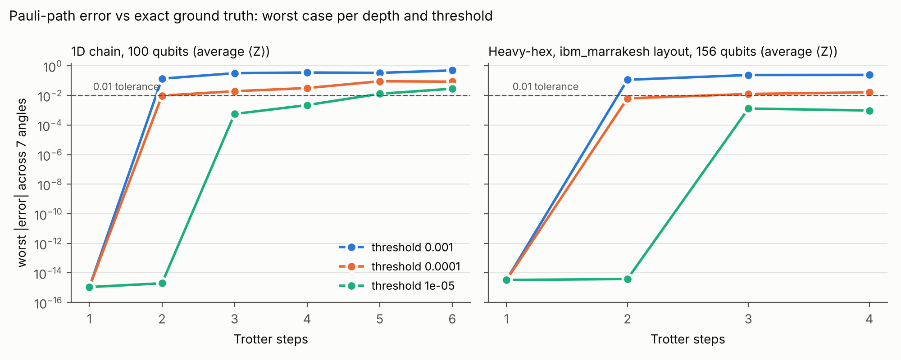
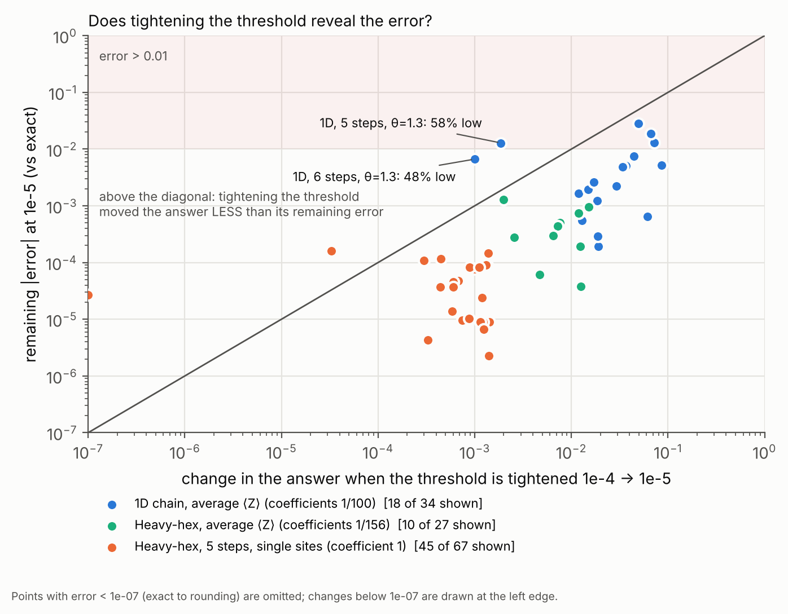

# Checking a cloud Pauli-path simulator against exact answers at 100–156 qubits

**Accuracy, a hidden scaling rule, and an inconsistent safety check in BlueQubit's `pauli-path` device**

Billy R. Davis Jr., IRMB (Independent Research in Multi-agent Benchmarking), Hudson Forge Technologies.
ORCID 0009-0000-4807-5851. Data collected 2026-11-21.

---

## Abstract

Pauli-path (Pauli-propagation) simulators estimate expectation values of circuits far beyond full-state simulation by tracking Pauli operators and discarding contributions below a truncation threshold. They are increasingly used to check, or to challenge, "beyond-classical" claims for circuits of more than 100 qubits. Their output carries no error bar, so a user cannot easily tell a correct answer from a truncated one.

We checked BlueQubit's cloud `pauli-path` device against **exact** values that we computed ourselves. The circuits are kicked-Ising evolutions (RX(θ) on every qubit, then RZZ(−π/2) on every coupling), the same family used in recent utility-scale hardware experiments. We ran them on a 100-qubit chain (1–6 steps) and on the 156-qubit heavy-hex layout of IBM's `ibm_marrakesh` (1–5 steps), at 7 angles and three truncation thresholds. Exact answers came from light-cone statevector simulation on a GPU and from exact tensor-network contraction. They were validated by three independent methods and reproduced on two machines (largest disagreement 3 × 10⁻¹²). In total we ran 547 BlueQubit jobs, at a cost of $0.

**Findings:**
1. In the shallow regime the simulator is accurate and fully deterministic. On heavy-hex at 5 steps the worst single-site error was 0.0016. Repeat runs were bit-identical in 17 of 17 cases.
2. **The truncation threshold is absolute.** Scaling an observable by *c* is exactly equivalent to multiplying the threshold by 1/*c* (bit-for-bit, difference ≤ 6 × 10⁻¹⁷). The common practice of normalizing an observable (for example, averaging 100 terms with coefficient 1/100) therefore coarsens the truncation 100-fold, with no indication in the output.
3. **The device's pre-run memory check is inconsistent with the computation it guards.** It refused 92 of 220 requests at the tightest threshold, not in order of difficulty. It refused an unscaled job whose mathematically identical rescaled version it then ran.
4. **Silent failures occur.** At the coarsest threshold the device returned exactly 0 in 5 cases where the true value was 0.014–0.137, with no warning. On the 1D chain at 5–6 steps, the natural self-check (tighten the threshold and see whether the answer moves) was fooled: answers stable to 0.002 were 48–58% below the true value. On heavy-hex up to 5 steps the self-check was never fooled.

---

## 1. Question

When a free cloud simulator returns an expectation value for a 100+ qubit circuit, **how close is it to the truth, and can the user tell from the output alone?** We answer this for one widely available implementation, BlueQubit's `pauli-path` device. We compare against exact values on circuits where exact computation remains possible.

## 2. Setup

### 2.1 Circuits

Each Trotter step applies RX(θ) to every qubit, then RZZ(−π/2) to every coupling, in a fixed order:
- **1D chain (100 qubits):** even bonds, then odd bonds.
- **Heavy-hex (156 qubits):** three edge-colour layers of the `ibm_marrakesh` coupling map (176 couplings, a proper 3-colouring), in `data/heavyhex/marrakesh_layers.json`.

The parameters are:
- θ ∈ {0.1, 0.3, 0.5, 0.7, 0.9, 1.1, 1.3}, using {0.5, … , 1.3} for heavy-hex at 5 steps;
- steps 1–6 on the 1D chain, 1–4 on heavy-hex (averaged observable), and 5 on heavy-hex (single sites).

The gate convention is Qiskit's: RZZ(φ) = exp(−iφ ZZ/2). At θ = π/2 every circuit is Clifford, and early checks used that point.

### 2.2 Observables

- **Averaged magnetization** ⟨Z⟩ = (1/n) Σᵢ⟨Zᵢ⟩, submitted as one Pauli sum with coefficient 1/n per term. Used for the 1D chain and for heavy-hex at 1–4 steps.
- **Single-site** ⟨Zᵢ⟩, with coefficient 1. Used for heavy-hex at 5 steps, on 30 sites chosen *before* any BlueQubit result by a fixed rule: the 30 sites with the largest exact-contraction cost that still fit, i.e. the hardest exactly-checkable sites.

The averaged observable is symmetric under qubit relabelling, so its value does not depend on BlueQubit's Pauli-string ordering. For single sites, a free probe established the ordering empirically: an X on qubit 0 gives −1 only with Qiskit-ordered strings, where the rightmost character is qubit 0 (`data/heavyhex/t5_ordering.json`).

### 2.3 Simulator and settings

- BlueQubit `pauli-path` device, Python SDK 0.19.1b1, run on 2026-11-21.
- Truncation thresholds: 10⁻³, 10⁻⁴ and 10⁻⁵. 10⁻⁵ is the smallest the SDK accepts.
- Every job was free (cost $0.00, recorded per job).

### 2.4 Exact ground truth (our own computation)

- **1D chain:** after T steps, Zᵢ depends only on qubits within 2T of i. Each site's window (radius 2T+1, at most 27 qubits) was simulated exactly with PennyLane `lightning.gpu` on an RTX 5070, using mirror and bulk symmetries.
- **Heavy-hex:** exact tensor-network contraction (quimb 1.16 + cotengra; exact simplifications only), one site at a time. The largest intermediate tensor was at most 2²¹ numbers at 1–4 steps. At 5 steps, 114 of 156 sites fit within 2²⁶; the other 42 were not used.

**Validation.** No number in this paper rests on a single method:

| Check | Agreement |
|---|---|
| 1D light-cone method vs full statevector (20 qubits) | 2.3 × 10⁻¹⁵ |
| 1D window radius R vs R+2 | 8.9 × 10⁻¹⁶ |
| 1D: Qiskit/Aer implementation vs PennyLane implementation (100 qubits) | 1.9 × 10⁻¹⁴ |
| 1D: all 42 values vs exact tensor-network contraction (third method) | 3.2 × 10⁻¹³ |
| Heavy-hex tensor network vs independent numpy statevector, all 156 sites, 2 steps | ≤ 1.5 × 10⁻¹⁴ |
| Same, every site with a ≤ 22-qubit window, 3 steps (37 sites) | ≤ 3.4 × 10⁻¹⁴ |
| Same, 5 steps (2 sites with ≤ 24-qubit windows) | 7.6 × 10⁻¹⁴ |
| Per-site 4-step average vs all-site 4-step value | 9.7 × 10⁻¹⁵ |
| Two machines (author's PC vs independent run), heavy-hex 28 averages / 570 site values | 1.9 × 10⁻¹⁴ / 3.0 × 10⁻¹² |

### 2.5 What "trustworthy" means here

The tolerance was fixed before the sweeps: an answer is within tolerance if |error| < 0.01 on ⟨Z⟩. Because absolute error can hide large relative error when the true value is small, both are reported. **False convergence** means that tightening the threshold from 10⁻⁴ to 10⁻⁵ moves the answer by less than the error that remains at 10⁻⁵. It is reported under the pre-set absolute rule (error > 0.01) and under a 10% relative criterion.

## 3. Results

### 3.1 Accuracy depends overwhelmingly on the threshold (Fig. 1)

| Worst \|error\| across angles | 10⁻³ | 10⁻⁴ | 10⁻⁵ |
|---|---|---|---|
| 1D, average ⟨Z⟩, 1–6 steps | 0.492 | 0.091 | 0.029 |
| Heavy-hex, average ⟨Z⟩, 1–4 steps | 0.245 | 0.016 | 0.0013 |
| Heavy-hex, single sites, 5 steps | not run | 0.0016 | 0.00016 |

At one step every answer is exact to rounding. At 10⁻³, errors reach about half the true value by three steps (1D: 6 steps, θ = 0.7, reported 0.098 against a true 0.589). Using the best threshold BlueQubit accepted for each circuit:
- all 28 heavy-hex averages and all 30 heavy-hex sites at every 5-step angle are within 0.01;
- on the 1D chain, 7 of 42 points are not (worst 0.035).

Full per-point tables are in `results/tables.md`.

### 3.2 Refusals: a pre-run check that does not track difficulty

At 10⁻⁵, BlueQubit refused **92 of 220** requests before running them, with `FAILED_VALIDATION: Truncation threshold used is too small … could lead to memory overflow`:
- 8 of 42 on the 1D chain;
- 1 of 28 for heavy-hex averages;
- 83 of 150 for heavy-hex single sites at 5 steps: 28, 27 and 28 of 30 at θ = 0.9, 1.1 and 1.3.

The refusals are not ordered by difficulty. The 1D chain at 2 steps, θ = 0.7 was refused, while 6 steps at the same angle was accepted. Two 1D points fall outside tolerance *only* because 10⁻⁵ was refused (4 and 5 steps at θ = 0.5, stuck at 10⁻⁴ with errors of 0.024 and 0.035), while the deeper 6-step circuit at the same angle was allowed 10⁻⁵ and landed within 0.0074.

### 3.3 The threshold is absolute, and the check is inconsistent with it

On the 1D chain we re-submitted the six hardest points (5–6 steps, θ = 0.9–1.3) with the **unscaled** sum Σᵢ Zᵢ (coefficient 1 per term) and divided by 100.
- All 12 requests (thresholds 10⁻⁴ and 10⁻⁵) were refused. The scaled versions had all run.
- Unscaled at 10⁻³ against scaled at 10⁻⁵: at 5 steps all three answers were **identical** (largest difference 5.6 × 10⁻¹⁷).

So scaling an observable by *c* is exactly equivalent to scaling the threshold by 1/*c*. The threshold acts on the absolute size of Pauli-path contributions. A normalized 100-term observable at "10⁻⁵" is effectively truncated at 10⁻³ per unit term.

At 6 steps, the device **refused** the unscaled 10⁻³ job, yet **ran** the mathematically identical scaled 10⁻⁵ job (`data/checks/equivalence_results.json`). A refusal therefore does not mean the computation is infeasible, and rescaling the observable silently gets past the check at the price of coarser accuracy.

### 3.4 Silent zeros

At 10⁻³ the device returned exactly **0.0** in 5 cases: 1D at 2, 4 and 6 steps, and heavy-hex average at 2 and 4 steps, all at θ = 1.3. The true values were 0.137, 0.037, 0.014, 0.114 and 0.024. No warning was given, and the result was indistinguishable in form from a correct value.

### 3.5 Determinism

We re-ran 17 jobs: the 8 refusals, 3 silent zeros, and the 6 largest-error answers. All 17 came back identical. Refusals were refused again, zeros were again exactly zero, and values matched to all 16 digits. The behaviours above are stable properties of the device, not run-to-run noise.

### 3.6 Can the user tell? False convergence (Fig. 2)

The natural self-check is to tighten the threshold and see whether the answer moves.

**On the 1D chain** it failed:

| Circuit | Change 10⁻⁴ → 10⁻⁵ | Remaining error at 10⁻⁵ | True value | Relative |
|---|---|---|---|---|
| 5 steps, θ = 1.3 | 0.0019 | 0.0128 | 0.0223 | **58% low** |
| 6 steps, θ = 1.3 | 0.0010 | 0.0067 | 0.0139 | **48% low** |

The first case meets the pre-set absolute rule; the second meets the relative criterion only. Both occur where the signal is small, which is also where tighter thresholds are refused.

**On heavy-hex** (27 averaged pairs at 1–4 steps and 67 single-site pairs at 5 steps) the self-check was never fooled under either criterion. Tightening the threshold always moved the answer by more than the error that remained.

### 3.7 Direction of the error depends on the observable

For the averaged observable the error was almost one-sided:
- 1D: 75 answers too low, 0 too high, 43 exact;
- heavy-hex average: 39 too low, 1 too high, 43 exact.

For single sites at 5 steps it was not: 102 too low and 104 too high. At θ = 0.7 and 0.9 with threshold 10⁻⁴, 28 and 27 of 30 sites came out too high. A truncated Pauli-path result is therefore **not** in general a lower bound.

### 3.8 Small-signal regime

At θ = 1.3 (true single-site values of order 0.01), 13 of 30 heavy-hex sites at 5 steps had relative errors above 10% at 10⁻⁴, all too low. The tighter threshold that would fix this was refused for 28 of the 30 sites. Absolute errors stayed at about 0.0005 or less.

## 4. Practical guidance for users of threshold-truncated Pauli-path simulators

1. **Never normalize an observable before submitting it.** Submit unit coefficients and rescale afterwards. Otherwise the requested threshold is not the threshold applied.
2. **Treat 10⁻³ as unusable** beyond one or two steps for this circuit family: errors reached 0.25–0.49, and exact zeros appear with no warning.
3. **A refusal is not a verdict on feasibility.** The same computation may be accepted when rephrased.
4. **Tightening the threshold is a weak self-check** when the signal is small. Where possible, validate against an exactly computable case of the same circuit family and depth, as done here.
5. **Do not assume truncation only underestimates.** The direction depends on the observable.

## 5. Limitations

- **One circuit family** (kicked Ising with Clifford couplings), **two geometries**, and depths up to 6 (1D) and 5 (heavy-hex). Deeper heavy-hex circuits are exactly where the interesting regime lies, but exact checking stops there: at 6 steps the required tensor contraction exceeds 2⁴⁹ numbers.
- The heavy-hex single-site study covers the 30 hardest *exactly checkable* sites. The 42 sites beyond exact reach are excluded by construction, and they may behave worse.
- The 1D chain is classically easy by construction, which is what makes exact checking possible. Findings about the threshold, the refusal check, silent zeros and determinism are properties of the device and are geometry-independent. Accuracy findings are specific to the circuits tested.
- This is **one simulator** (BlueQubit `pauli-path`, SDK 0.19.1b1, November 2026). Its internals are not public; the threshold rule (Section 3.3) was established empirically.
- The study was **not pre-registered**. The tolerance (0.01), thresholds, angles and the site-selection rule were fixed before the corresponding BlueQubit runs. The scaling test (Section 3.3) was added after the 1D sweep, to explain a discrepancy, and is reported as such. Twelve exploratory jobs run before the sweeps are excluded from the dataset but disclosed in `README.md`: a 100-qubit pilot (2 pauli-path, 2 refused MPS) and an 8-job threshold pilot. Their results agree with the sweeps.

## 6. Reproducibility

- **Data:** every BlueQubit job (value, threshold, cost and job ID) is in `data/`. The exact values and their self-check records are alongside.
- **Analysis:** `python analysis.py` regenerates `results/summary.json`, `results/tables.md` and both figures from `data/` alone.
- **Ground truth:** `code/lc_exact.py` (1D, GPU), `code/hh_exact.py` and `code/hh5_exact.py` (heavy-hex, tensor network).
- **Sweeps:** `code/bq3_sweep.py`, `code/hh_sweep.py` and `code/hh5_sweep.py`, plus checks in `code/bq3_repeat.py`, `code/bq3_scale.py` and `code/bq3_equivalence.py`. All are resumable and stop if any job is charged.
- **Related observation (not part of this dataset):** BlueQubit's `quantum` hardware device returns measurement bitstrings with classical bit 0 first, while its Pauli strings use Qiskit order (qubit 0 last). Users mixing the two interfaces should check orientation explicitly.
