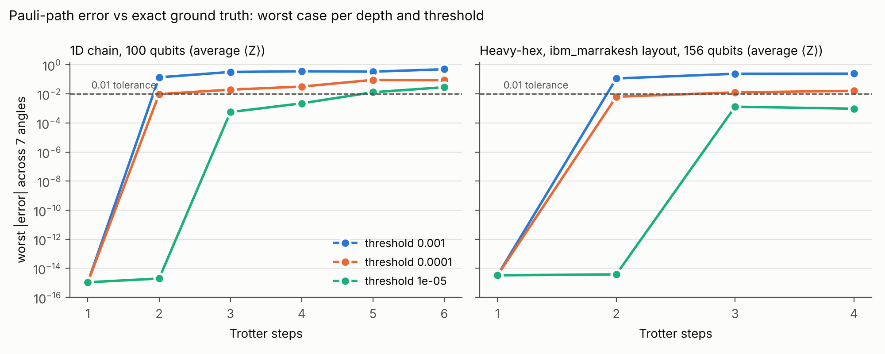

# IRMB PPV-P1: Pauli-path simulation checked against exact answers at 100–156 qubits

This project tests a free cloud simulator (BlueQubit's `pauli-path` device) on kicked-Ising circuits, the family used in recent "beyond-classical" hardware experiments. The circuits run on a 100-qubit chain and on the 156-qubit heavy-hex layout of IBM's `ibm_marrakesh`. Every answer is compared with an exact value we computed ourselves, validated by independent methods and reproduced on two machines.

**Full write-up:** [`PAPER.md`](PAPER.md)

## Headline results (547 BlueQubit jobs, $0)

| Finding | Evidence |
|---|---|
| Accurate in the shallow regime | Heavy-hex, 5 steps, 30 hardest checkable sites: worst error 0.0016 |
| Fully deterministic | 17 of 17 repeats bit-identical, refusals and zeros included |
| **The threshold is absolute** | Scaling an observable by *c* ≡ threshold × 1/*c*, identical to 6 × 10⁻¹⁷; normalizing a 100-term observable silently coarsens truncation 100-fold |
| **The pre-run check is inconsistent** | 92 of 220 tightest-threshold requests refused, not in order of difficulty; an unscaled job was refused while its identical rescaled version ran |
| **Silent failures** | 5 exact-zero results with no warning (true values 0.014–0.137); on the 1D chain, answers stable under threshold tightening were 48–58% low |



## Layout

| Path | Contents |
|---|---|
| `PAPER.md` | Write-up: setup, validation, results, guidance, limitations |
| `analysis.py` | Regenerates every number, table and figure from `data/` (`python analysis.py`) |
| `data/1d/` | 1D sweep (126 jobs) and its exact values |
| `data/heavyhex/` | Heavy-hex layout, average sweep (84 jobs), 5-step per-site sweep (300 jobs), exact values, ordering probe |
| `data/checks/` | Repeat (17), scaling (12) and equivalence (6) checks |
| `results/` | `summary.json` and `tables.md` (generated) |
| `figures/` | Fig. 1 and Fig. 2 (generated) |
| `code/` | Ground-truth generators, sweeps and checks exactly as run |

## Reproduce

```bash
pip install numpy matplotlib
python analysis.py
```

To rerun the experiments you need a BlueQubit token in `~/.bq_token`:
- **1D ground truth:** PennyLane 0.45.1 with `lightning.gpu`.
- **Heavy-hex ground truth:** quimb 1.16.0 and cotengra 0.8.4.
- **Sweeps:** Qiskit plus the BlueQubit SDK 0.19.1b1.

Each script states its own inputs and outputs. All sweeps are resumable and stop if any job is charged.

## Disclosure

The study was not pre-registered. The tolerance, thresholds, angles and site-selection rule were fixed before the corresponding runs. The scaling and equivalence checks were added afterwards to explain a discrepancy.

Twelve exploratory jobs before the sweeps are not in `data/`; their results agree with the sweeps:
- `code/bq3_probe.py` check: 2 Pauli-path jobs, and 2 MPS jobs refused because MPS is limited to 98 qubits;
- an 8-job threshold pilot.

Self-funded independent research, Independent Research in Multi-agent Benchmarking (IRMB), Hudson Forge Technologies. MIT licence (code); data CC BY 4.0.
